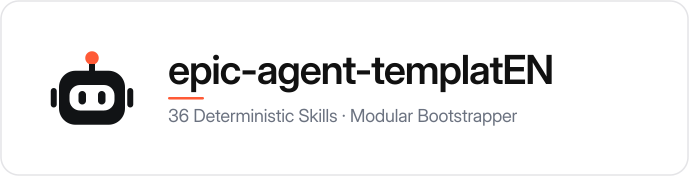
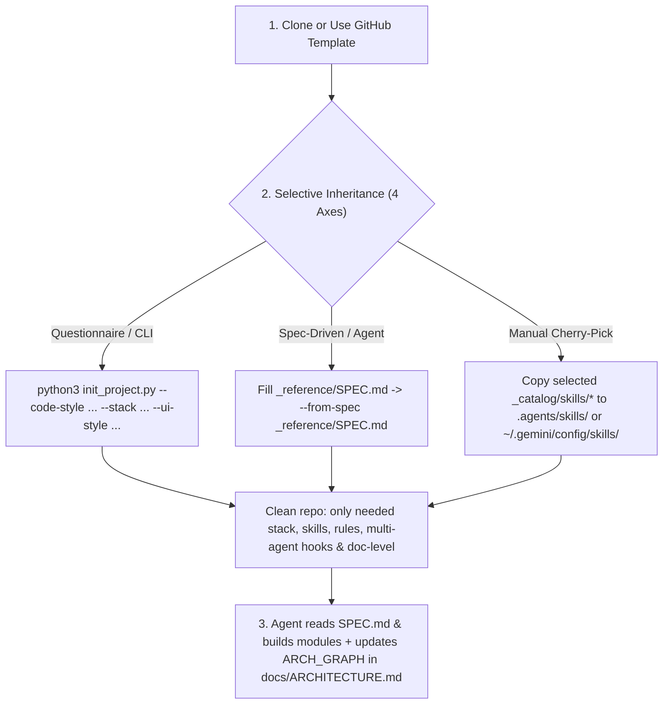

[English](README.md) | [Español](docs/README.es.md)

<p align="center">
  <picture>
    <source media="(prefers-color-scheme: dark)" srcset="docs/assets/brand/epic-agent-templaten-banner-dark.png">
    <source media="(prefers-color-scheme: light)" srcset="docs/assets/brand/epic-agent-templaten-banner-light.png">
    
  </picture>
</p>

# epic-agent-templatEN

[](https://www.python.org/)
[](TEMPLATE_GUIDE.md)
[](TEMPLATE_GUIDE.md)
[](LICENSE)

## Project Overview

**epic-agent-templatEN** is a modular agent-first project template with an interactive bootstrapper that prunes **36 deterministic engineering, frontend, research, and gamedev skills** to fit your exact stack (for greenfield projects or non-destructive brownfield adoption via `--adopt`). Engineered natively for **Google Antigravity (Gemini)** and open Agent Skills hosts, every skill follows progressive disclosure (`SKILL.md` with third-person triggers, Decision Trees, and black-box `--help` scripts) and ships deterministic Python/Node/Bash tooling instead of hollow prompts.

Key capabilities designed for real engineering and game development:
1. **Live Knowledge Graph (`docs/ARCHITECTURE.md`):** `sync_arch_graph.py` extracts AST functional blocks, public exports, and dependency edges into Mermaid + tables, giving both humans and Gemini a zero-bloat navigation map even on large repos.
2. **2D Game Art, Pixel Art & Audio Suite (Zero 3D Bloat):** Specialized 2D tools (CIELAB pixel quantization, `PixelSpec` variants, soft-matte chroma keying, sole-Y sprite surgery, Wang-16 zero-seam autotiles, procedural FX/shaders, and DSP WAV SFX synthesis), strictly separated from 3D mesh QA (`--dim 2d` vs `3d`).
3. **Anti-Laziness & Long-Context Guardrails:** Blocks stubs, `NotImplementedError`, and lazy simplified demos via AST gates (`verify_completion.py`), while `.agents/current_state.md` anchors long chats against goal drift.
4. **5-Step Selective Inheritance (`init_project.py` & `_catalog/catalog.json`):** Configure coding philosophy (`minimal-yagni`, `clean-ddd`, `functional-dod`), project nature + modular `--scope` + `--infra` (`single-node` | `split-cpu-gpu`), frontend aesthetic (`minimalist`, `neobrutalist`, `bento`, `glassmorphic`, `enterprise`, `editorial`, `terminal`, `fluid`) or `--dim 2d|3d`, and modular optional docs on top of mandatory `README.md` + `docs/ARCHITECTURE.md` via interactive questionnaire or `--from-spec _reference/SPEC.md` — projecting universal rules & hooks for Antigravity, Gemini CLI, and Claude Code. Unused catalogs and setup scripts auto-clean after initialization.

## Repository Structure

```text
epic-agent-templatEN/
├── AGENTS.md                   # Bilingual engineering rules & zero-duplication doc matrix
├── Makefile                    # Universal entrypoint (help, setup, dev, lint, format, test, verify)
├── TEMPLATE_GUIDE.md           # Full flag, stack, and 36-skill reference (auto-removed on init)
├── init_project.py             # 5-step modular questionnaire, spec router & auto-cleaner (auto-removed on init)
├── evals/                      # Reproducible functional eval suite across all 33 skills (auto-removed)
├── .agents/                    # Always-on quality rules, hooks & active 1-level workspace skills
├── _reference/                 # Private sandbox: write project intent in SPEC.md (ignored on init)
├── _catalog/                   # Modular library removed after project initialization
│   ├── catalog.json            # Machine-readable skill index (stacks, 2D/3D dims, capabilities)
│   ├── skills/                 # 33 executable Agent Skills across 8 folders
│   ├── stacks/                 # 6 declarative stacks (stack.json, stack.mk, CI, templates)
│   ├── rules/                  # Stack-scoped rules & local AGENTS.md layers
│   ├── addons/                 # Optional Docker & Dotenv modules
│   └── docs/                   # Project README & benchmark templates
└── docs/                       # Live Knowledge Graph Architecture, User Guide, brand assets (auto-cleaned), and ADRs
```

## How It Works (Clone -> Select -> Specify -> Build)



### Modular Stacks & Granular Profiles

| Stack | Target Use Case | Granular Dimensions / Profiles |
| :--- | :--- | :--- |
| **`web-frontend`** | React, Next.js, Svelte 5, Astro, or Vanilla TS | `--ui-style minimalist\|neobrutalist\|bento\|glassmorphic\|enterprise\|editorial\|terminal\|fluid` + optional `--features dataviz` |
| **`python-cli`** | Installable Python 3.12+ CLI / library (`src/<pkg>/`) | `--doc-level minimal` default, optional `dotenv` |
| **`python-backend`** | Layered API (`api -> services -> domain <- infra`) | Docker (`deps/dev/prod`), `dotenv` (`core`, `web-api`), `src/AGENTS.md` |
| **`multi-module`** | Decoupled `backend/` + `frontend/` monorepo | `--ui-style` (7 presets or `fluid`) + `backend/AGENTS.md` + optional `dataviz` |
| **`ml-gpu`** | Portable PyTorch/CUDA pipelines (CPU/MPS laptops -> GPU VM) | Docker `gpu` profile + `--doc-level full` (`BENCHMARKS.md`) |
| **`gamedev-godot`** | Godot 4.x + C# (.NET 8+) pure `Domain/` + Art/Audio | `--dim 2d` (8 gamedev skills: 5 2D art/audio + 3 Godot core, zero 3D) or `--dim 3d` (GLB QA) |

## Quickstart (Clone & Use)

1. Click **Use this template** on GitHub (or run `git clone <repo-url> my-project && cd my-project`).
2. **Bot Mode (Zero-CLI):** Open the folder in Antigravity and tell the agent: *"Interview me to bootstrap this project"* — it reads Section 0 of `AGENTS.md`, runs the 5-step questionnaire in chat, persists `_reference/SPEC.md`, runs `init_project.py`, and auto-cleans the template scaffolding.
3. **CLI Mode:** Run the interactive wizard or pass flags directly:

```bash
# 1. Interactive 5-step questionnaire (code-style, nature/scope/infra, ui-style/dim, extras, docs)
python3 init_project.py

# Or initialize a web app with Clean/DDD + Neobrutalist UI directly
python3 init_project.py --code-style clean-ddd --stack web-frontend --ui-style neobrutalist --name my-app --yes

# Or initialize a 2D Godot C# game directly (zero 3D/web/Docker bloat)
python3 init_project.py --stack gamedev-godot --dim 2d --name my-2d-game --yes

# Or initialize straight from your checkboxes in _reference/SPEC.md
python3 init_project.py --from-spec _reference/SPEC.md --name my-project --yes

# Or compose modularly by scope (API + ML/GPU + scientific research + split CPU/GPU topology)
python3 init_project.py --code-style clean-ddd --scope api,ml-gpu,research --infra split-cpu-gpu --docs user-guide,agent-guide --name my-research-service --yes

# Or adopt non-destructively into an existing repository (injects .agents/, hooks, rules & size ratchet)
python3 init_project.py --adopt /path/to/existing-repo --scope api,ml-gpu,profiling,research --infra split-cpu-gpu --yes

# Or inspect all 36 skills and cherry-pick manually
python3 init_project.py --list-catalog
```

<details>
<summary>Catalog Summary: All 36 Gemini-Optimized Executable Skills (Click to Expand)</summary>

Every skill follows progressive disclosure, `## Decision Tree` routing, black-box `--help` execution, and zero pure-prompt fluff. See [Template Guide](TEMPLATE_GUIDE.md) for every script and CLI flag.

- **`00-core/` (9):** `long-context-state-manager`, `anti-laziness-and-evidence-verifier`, `repo-map-and-context-pack`, `architecture-knowledge-and-docs-sync`, `clean-code-and-architecture-gate`, `systematic-debugging-and-rca`, `skill-authoring-and-updater`, `skill-radar-and-proposals`, `reference-harvest-and-prune`
- **`gamedev/` (8, 2D & C# Core):** `godot-architecture-and-static-audit`, `godot-scene-and-input-audit`, `godot-headless-testing`, `godot-2d-sprite-and-art-pipeline`, `godot-2d-pixel-art-forge`, `godot-2d-rig-and-fx-animator`, `godot-2d-autotile-and-parallax`, `godot-procedural-audio-and-sfx`
- **`gamedev-3d/` (1, 3D Opt-In Only):** `godot-3d-asset-and-rig-qa`
- **`frontend/` (6):** `frontend-quality-and-design-gate`, `frontend-lighthouse-and-design-audit`, `ui-design-tokens-and-presets`, `ui-fluid-novel-system`, `frontend-dataviz-and-charts`, `brand-logo-and-svg-forge`
- **`backend/` (4):** `backend-quality-and-contracts`, `backend-security-and-owasp-gate`, `api-openapi-contract-gate`, `db-migration-and-schema-gate`
- **`github/` (1):** `git-commit-and-pr-gate`
- **`testing/` (2):** `test-and-mutation-gate`, `runtime-profiling-and-observability`
- **`infra/` (2):** `docker-and-env-auditor`, `ml-gpu-workload-harness`
- **`research/` (3, Opt-In `--scope research`):** `research-paper-and-literature`, `research-rigor-and-experiments`, `research-manuscript-and-prose-gate`

</details>

## Documentation

| Document | Link | Primary Purpose |
| :--- | :--- | :--- |
| **Template & CLI Guide** | [Template Guide](TEMPLATE_GUIDE.md) | Complete reference of flags, 6 stacks, 5 steps, `--adopt`, and 36 skills (auto-removed on init) |
| **Guía en Español** | [Español](docs/README.es.md) | Resumen del sistema y flujo de uso en español |
| **System Architecture** | [Architecture](docs/ARCHITECTURE.md) | Central knowledge graph (`ARCH_GRAPH`) & module boundaries |
| **User Guide** | [User Guide](docs/USER_GUIDE.md) | Environment setup, `make` interface, and troubleshooting |
| **Architecture Decisions** | [ADRs](docs/adr/README.md) | Decision log index and template |

## License

Licensed under the [Apache License 2.0](LICENSE).
