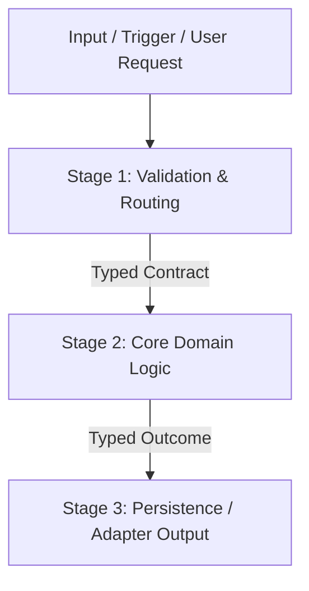

{{LANG_SWITCHER}}

# {{PROJECT_NAME}}

{{STACK_BADGES}}

{{VISUAL_PREVIEW_COMMENT}}

## Project Overview

**{{PROJECT_NAME}}** — {{ONE_SENTENCE_PROJECT_PITCH}}

Key engineering constraints addressed by this system:
1. **Deterministic Contracts:** Explicit input/output schemas separating data ingestion, core logic, and adapters.
2. **Reproducible Execution:** Isolated environment setup and single-command verification (`make verify`).
3. **Traceability:** Clear module boundaries and verification evidence across every stage.

## Repository Purpose

This repository implements the modular core, runtime entrypoints, and automated verification suite for **{{PROJECT_NAME}}** using the `{{STACK_NAME}}` stack.

## Project Structure

```text
{{PROJECT_NAME}}/
├── .agents/                # Active Antigravity rules, hooks, and stack-scoped skills
├── docs/                   # Architecture, User Guide, ADRs{{BENCHMARK_DOC_NOTE}}
├── {{PRIMARY_CODE_DIR}}    # Primary application source code
├── Makefile                # Universal command interface (make help)
└── README.md               # Project overview & quick execution guide
```

## Modular Architecture and Data Flow

> High-level overview. Detailed component/sequence diagrams and module rules live in [Architecture](docs/ARCHITECTURE.md).



### Phase and Contract Specification

| Stage | Module / Path | Input | Internal Responsibility | Output |
| :--- | :--- | :--- | :--- | :--- |
| **Stage 1** | `{{PRIMARY_CODE_DIR}}` | Raw request / CLI args / scene event | Validates input schema and routes execution | Typed input contract |
| **Stage 2** | `{{PRIMARY_CODE_DIR}}` | Validated domain input | Executes pure domain rules without framework coupling | Domain outcome |
| **Stage 3** | `{{PRIMARY_CODE_DIR}}` | Domain outcome | Persists state, renders view, or formats API response | Verified response / artifact |

## Deployment and Execution

### Prerequisites
- {{PREREQUISITE_1}}
- `make` and `git`

### Quickstart Commands

```bash
# 1. Install dependencies and configure git hooks
make setup

# 2. Run local development mode
make dev

# 3. Run full static + test verification gate
make verify
```

<details>
<summary>Extended Execution & Troubleshooting Notes</summary>

1. Inspect all stack-specific targets with `make help`.
{{USER_GUIDE_EXTENDED_NOTE}}

</details>

{{DOCKER_README_BLOCK}}

## Documentation

| Document | Link | Primary Scope |
| :--- | :--- | :--- |
| **System Architecture** | [Architecture](docs/ARCHITECTURE.md) | Component/sequence Mermaid diagrams, module dependency boundaries, and live knowledge graph |
{{USER_GUIDE_DOC_ROW}}{{BENCHMARKS_DOC_ROW_ROOT}}{{ADR_DOC_ROW}}

## License

Licensed under the [Apache License 2.0](LICENSE).
