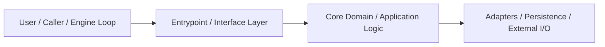
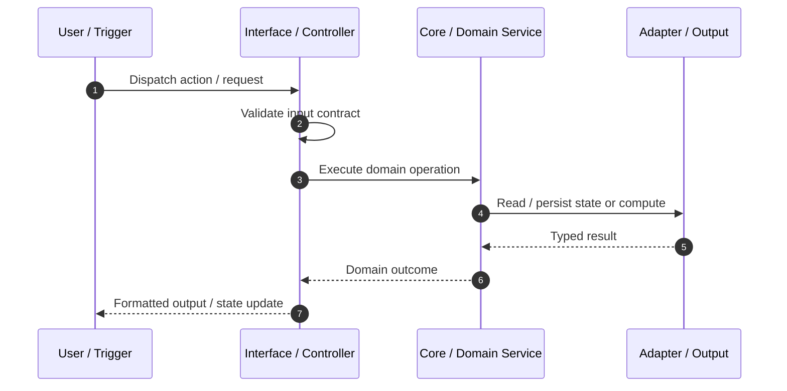

# System Architecture

> Canonical owner of system boundaries, component interactions, directory topology, and module dependency rules. Do not duplicate installation or usage instructions here (see [User Guide](USER_GUIDE.md)).

## 1. Overview & System Boundary

{{High-level summary of what the system does, its primary execution environment, and its strict boundaries based on `_reference/SPEC.md`.}}

---

## 2. Context & Component View

### Component Responsibilities

| Component / Module | Path | Primary Responsibility |
| :--- | :--- | :--- |
| **Entrypoint / Interface** | `{{e.g., src/pkg/api, frontend/, scenes/}}` | Handles user input, routing, UI rendering, or CLI arguments |
| **Core / Domain** | `{{e.g., src/pkg/domain, core/}}` | Pure business rules, state transitions, and domain contracts |
| **Infrastructure / Adapters** | `{{e.g., src/pkg/infra, services/}}` | External integrations, storage, file I/O, or hardware/GPU runtimes |

---

## 3. Primary Execution Flow

---

## 4. Module Boundary & Dependency Rules

To prevent circular dependencies and spaghetti coupling, modules must obey the following dependency matrix:

| Source Module | May Import From | Must NEVER Import From |
| :--- | :--- | :--- |
| `{{core / domain}}` | Standard library, shared types | `{{interface / ui / api}}`, `{{infra / adapters}}` |
| `{{application / services}}` | `{{core / domain}}` | Concrete `{{interface / ui / api}}` implementations |
| `{{infra / adapters}}` | `{{core / domain}}`, external SDKs | `{{interface / ui / api}}` |
| `{{interface / ui / api}}` | `{{application / services}}`, `{{core / domain}}` DTOs | Direct low-level `{{infra}}` internals |

---

## 5. Technology Stack Summary

| Concern | Technology | Rationale / ADR Link |
| :--- | :--- | :--- |
| **Language & Runtime** | `{{...}}` | See [ADR-0001](adr/README.md) |
| **Core Framework / Engine** | `{{...}}` | `{{...}}` |
| **Quality & Testing** | `{{...}}` | Enforced via `make verify` |

---

## 6. Live Module Knowledge Graph

> Auto-updated by `sync_arch_graph.py --write` so both humans and Gemini can navigate high-level blocks without loading the entire repository.

<!-- ARCH_GRAPH:START -->
_No source code modules scanned yet. Run `sync_arch_graph.py --write` once source modules exist._
<!-- ARCH_GRAPH:END -->
