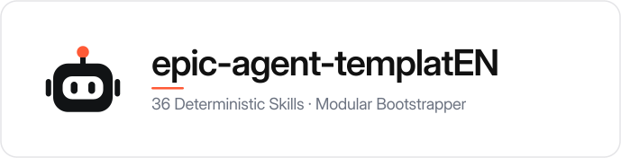

[English](../README.md) | [Español](README.es.md)

  <picture>
    <source media="(prefers-color-scheme: dark)" srcset="assets/brand/epic-agent-templaten-banner-dark.png">
    <source media="(prefers-color-scheme: light)" srcset="assets/brand/epic-agent-templaten-banner-light.png">
    
  </picture>

# epic-agent-templatEN (Guía Rápida en Español)

Plantilla de ingeniería nativa para **Google Antigravity (Gemini)**, **Gemini CLI** y **Claude Code** con núcleo cero-tecnología, **36 skills ejecutables respaldadas por scripts reales** (sin prompts vacíos), flujo completo de **investigación científica (`--scope research`)**, suite de **Arte 2D / Pixel Art / Vector / Audio DSP / Shaders**, adopción no destructiva en repos existentes (`--adopt`) y **Grafo de Conocimiento vivo** en `docs/ARCHITECTURE.md`.

## Flujo de Uso en 5 Pasos (Clonar -> Cuestionario / Bot -> Especificar -> Construir)

1. **Configuración modular (`init_project.py`, `_reference/SPEC.md` o Modo Bot conversacional en el chat):**
   - **Paso 1 — Filosofía de código (`--code-style`):** `minimal-yagni` (escalera Ponytail), `clean-ddd` (Clean Architecture / DDD) o `functional-dod` (Funcional / DOD).
   - **Paso 2 — Naturaleza, Alcance Modular (`--scope`) e Infraestructura (`--infra`):**
     - Naturaleza: `app-system`, `library-cli` o `game`.
     - Alcance composable en `app-system`: `frontend`, `api` (inyecta `api-openapi-contract-gate`), `db` (inyecta `db-migration-and-schema-gate` **solo si lleva BD**), `ml-gpu`, `profiling` y `research` (papers PDF/citas, rigor Q1 anti-data-leakage, LaTeX/estilometría/figuras).
     - Topología (`--infra`): `single-node` (1 máquina) o `split-cpu-gpu` (divide CPU/UI/API y worker GPU/DB en varias máquinas con `compose.yaml` por perfiles `app-cpu`/`db`/`gpu-worker` y variables `REMOTE_WORKER_URL`).
   - **Paso 3 — Estética frontend (`--ui-style` y `--ui-tone dark|light`):** 7 presets (`minimalist` 4 fases estilo Retriever dark/light, `neobrutalist`, `bento`, `glassmorphic`, `enterprise`, `editorial`, `terminal`) o `fluid`, más `--with-dataviz` y `--with-brand-logo`.
   - **Paso 4 — Dimensión de juego (`--dim 2d | 3d`):** `2d` por defecto como camino rápido principal (aislando al 100% las skills 2D de las 3D).
   - **Paso 5 — Selección de documentación (`--docs`):** obligatorios `README.md` y `docs/ARCHITECTURE.md`; opcionales elegibles `user-guide`, `adr`, `agent-guide`, `benchmarks`, `es`.
2. **Describe tu intención en `_reference/SPEC.md` o pídele al agente que te entreviste:** El bloque de Modo Bot en `AGENTS.md` guía al agente para entrevistarte, rellenar `_reference/SPEC.md`, ejecutar `init_project.py` y autolimpiarse.
3. **Transforma y navega el repo con Gemini:** `docs/ARCHITECTURE.md` mantiene un bloque vivo `ARCH_GRAPH` (Mermaid + tabla de bloques y exports AST).

## Documentación Relacionada

- [Template Guide (EN)](../TEMPLATE_GUIDE.md): referencia completa de flags (`--code-style`, `--scope`, `--infra`, `--ui-style`, `--ui-tone`, `--docs`, `--adopt`, `--from-spec`), stacks y las 36 skills.
- [System Architecture](ARCHITECTURE.md): mapa central y grafo de módulos (`ARCH_GRAPH`).
- [User Guide](USER_GUIDE.md): guía de comandos `make`, variables y resolución de problemas.
- [ADRs](adr/README.md): registro de decisiones de arquitectura.
